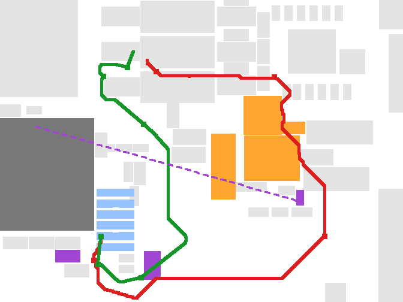
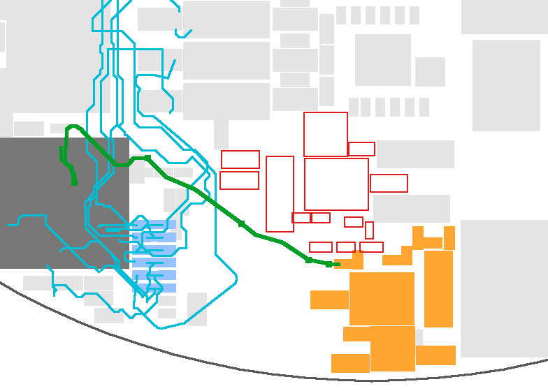

# Unified Control Board 36V: revisions

The 36 V Unified Control Board: ESP32-S3 XY controller plus an STM32G474 (U20) driving the spindle from a 36 V bus.

Each revision is a git tag on the commit that holds its design files. The revision is printed on the top silkscreen
under the board name ("UNIFIED CONTROL BOARD / 36V   v1.0", at x 7.5, y 61–64 mm). That text is
`v${REVISION}`, so it follows the Rev field of the board's title block: change the Rev there and the silkscreen
changes with it.

| Revision | In git | Status |
|---|---|---|
| v1.0 | tag `hw/ucb-36v/v1.0` (commit 484b1944b) | Built and assembled: board 1 (`maslow36v.local`) |
| v1.1 | branch `36V-board-v1.1` | Layout done, DRC clean. Fab files not regenerated, sync firmware not written |

To open an older revision without touching your checkout:

```bash
git worktree add ../ucb-36v-v1.0 hw/ucb-36v/v1.0
```

The tags start with `hw/` so the firmware release workflow, which runs on `v*.*.*` tags, never picks them up.

## v1.0

v1.0 is the design that was ordered and assembled as board 1. The only change at tagging was the revision text on
the silkscreen and in the title block.

### Known problem: U9's switching noise in the current sense

U9 (TPS54360B, the 36 V to 3.3 V buck) switches at about 480.7 kHz, free-running on R30. The G474 samples the
six phase currents at 20 kHz. The buck's switching edges drift through the sampling instant, so the ripple
aliases to a slow beat (about 550 Hz at 20 kHz PWM). It moved to 4222 Hz at 20.2 kHz PWM, which is
24 × 20,204 Hz − 480.7 kHz.

- All six channels move together. That is one disturbance on what they share: the 3V3A bias and reference, fed
  from 3V3 through the ferrite FB1, and the ground.
- Motor 1 phase B is five times worse than the other channels, and in opposite phase. Its shunt-side net SB1 took
  a 76 mm detour that ran on In2 directly over U9's switch node and L1. Its edge was −0.28 mm from SW_NODE copper
  (overlapping in plan view) and 0.14 mm from L1's body.
- The noise doubled when the bus went from 24 V to 36 V, because the switch node swings the full bus voltage.

The G474 firmware works around it (spindle-g474 on branch `36V-G474-firmware`, BRINGUP.md step 7):
- The comparator trip is raised to 30 A, with a 0.75 µs filter (BKF 0xC).
- The software trip is 18 A, five samples in a row.

The defaults were 20 A and 15 A × 3.

### Reworks to try on a v1.0 board

These are the v1.1 changes done by hand, in order of value. Coordinates are KiCad board coordinates in mm.

1. **Bench-supply test (no parts removed).** This test shows whether U9 is the whole story.
   - Hold 3V3 at 3.35–3.4 V from a linear lab supply, wired to C33's pads, with a 1 A limit. U9 regulates to
     3.28 V and can't sink current, so it stops switching.
   - Turn on 36 V first, then 3.3 V. Turn off in the reverse order.
   - Then compare `#NOISE`, `#CMPTEST` and a 24k spin against the BRINGUP.md numbers.
2. **SB1 reroute.**
   - Cut the top-layer segment from (−24.3, 70.0) to (−24.3, 71.7), just before SB1 drops to R117.
   - Run a wire on the bottom from R114 pin 1 (−20.1, 44.2) to R117 pin 1 (−24.0, 66.2).
   - The old detour is then left attached only at the shunt, 5 mΩ from ground.
3. **3V3A filter.** Replace FB1 with a 4.7 Ω 0603 and add 10–22 µF on 3V3A next to C145.
4. **Sync bodge.**
   - Fit a 10 pF C0G capacitor on R30's pad 1, which is U9's RT/CLK node, on the bottom.
   - Run a fine wire from its other end to U20 pin 57 (PB4). PB4 is unconnected on v1.0.
   - Needs the sync firmware described below.

## v1.1 (in progress)

v1.1 fixes the noise at the source. SB1 no longer runs over the buck (change 1), and the buck itself moves away
from the motor stage and the sense nets, down to the curved bottom edge of the board (change 4).

### Changes

**1. SB1 rerouted away from U9.**
- All of v1.0's SB1 copper is removed (70 items, including the tap at Q13's source pads).
- SB1 now runs from R114's own pad 1, a Kelvin tap at the shunt, to R117's via-in-pad at (−24.0, 66.2).
- The new route is 47.5 mm long with 5 vias (B.Cu 10 mm, F.Cu 11 mm, In2 26 mm). It stays at x ≤ −13.8 mm, west
  of the buck.
- With U9 still in its v1.0 place, this alone gave 5.5 mm to SW_NODE copper and 9.9 mm to L1's body, the same
  clearance SA1 had. In v1.0 it was −0.28 mm and 0.14 mm. With the buck moved (change 4) it is 13.6 mm and 15.4 mm.
- The before/after map is `docs/v1.1-SB1-before-after.png` (drawn before the buck moved).



**2. 3V3A RC filter.**
- FB1 (600 Ω at 100 MHz ferrite, only a few ohms at 480 kHz) becomes R178, 4.7 Ω 0603 (AC0603FR-074R7L, LCSC
  C144651). It sits in the same place, at (−27.9, 68.6) on the top.
- New C164, 22 µF 0805 (CL21A226MAQNNNE, C45783), on the bottom at (−17.8, 69.7), tied to R120's 3V3A pad.
- The corner frequency moves to about 1.5 kHz, roughly 30× more attenuation at the buck frequency than before.
- About 10–20 mA flows through R178, so 3V3A sits 50–100 mV below 3V3. That is harmless: the sense bias, the ADC
  reference (VREF+) and the comparator DAC all come from 3V3A, so they drop together, and the offsets are
  calibrated at startup.

**3. U9 synchronised to the PWM.**
- New C165, 10 pF C0G 0402 (CL05C100JB5NNNC, C32949), on the bottom beside R30, 2.7 mm of track from U9 pin 4
  (RT/CLK).
- The new net U9_SYNC runs from U20 pin 57 (PB4, TIM3_CH1 on AF2) to C165: 43.6 mm, 5 vias, top and bottom layers
  only.
  - PB4 is the only spare timer pin that gets out of the G474's fan-out at all (PB5, next to it, routes the same
    way; PB10, PA4, PC9, PA9, PA10, PB3 and PB9 have no route). Its first two vias duck under the G474 to escape.
  - No high-impedance sense node (IS*) comes within 2 mm of it on the same layer. Its closest neighbours are
    TEMP2 (a slow thermistor input, 0.57 mm, for 4.8 mm) and a crossing of SA1 (shunt side, 0.67 mm).
- This is the TPS54360B datasheet's (SNVSB93) recommended way to drive RT/CLK from a low-impedance clock: AC
  coupling through 10 pF, with RT staying in place to ground.
- R30 (200 kΩ, about 500 kHz) still sets the free-running frequency. The buck runs at that frequency until the
  clock arrives, and falls back to it if the clock stops (G474 reset or bootloader).

**4. The 3V3 buck moved to the curved bottom edge** (`tools/v1.1_u9move.py`).
- U9 goes from (−3.6, 56.9), beside motor 1's stage and sense routes, to (1.1, 68.6), turned 180° so its switch node
  (pin 8, D5, L1) faces east, away from the sense side. L1 sits by the board edge.
- U9, L1, D5, C31 and C32 keep their layout and bottom-layer copper. The feedback, compensation and RT parts (R27,
  R29, R30, C165, R31, C29, C30) are re-placed so FB, COMP and RT each leave their pin directly: FB 3.1 mm, COMP
  6.6 mm, RT 2.7 mm of track. v1.0's COMP had to hop through In2.
- The output caps C33 (22 µF) and C23 (10 µF) move next to L1's output pad. They were 9 mm away, so the output ripple
  current ran through the 3V3 plane and the ground under the stage.
- That area is crossed on the top layer by a bundle of long signals (BoardCOM1, INLA1, SPINDLE_RST_X, 12V_GD), so the
  buck keeps its copper on the bottom layer. Vias only go where the bundle leaves room.
  - U9's thermal pad now joins the bottom ground pour solidly (it had thermal spokes) and keeps 2 vias (it had 5).
  - R27's 3V3 tap and L1's output each have a via to the 3V3 plane.
  - Seven more ground vias tie the bottom pour around the buck to the top pour: two that moved with D5, and five
    new ones by the ground pads of C33, C23, D5, C29 and R30.
- Re-routed because of the move:
  - VSUP from D1, D2 and C28 to C32, the new input hub.
  - INLC1: its In2 hop ended in a via where C32's ground pad now sits. It is now top layer only.
  - BoardCOM2: its In2 run would have crossed right over the new switch node. It now runs on the top layer past the
    buck and drops to In2 well clear of it.
- Switch-node copper to the nearest sense nets, edge to edge:

  | Net | v1.0 | v1.1 before the move | v1.1 |
  |---|---|---|---|
  | SB1 | −0.28 mm (over it) | 5.5 mm | 13.6 mm |
  | SA1 | 5.9 mm | 5.9 mm | 19.4 mm |
  | SA2 | 6.3 mm | 6.3 mm | 22.2 mm |
  | SC1 | 9.4 mm | 9.4 mm | 22.9 mm |
  | nearest IS* (MCU side) | 11.9 mm | 11.9 mm | 20.4 mm |

  L1's body is now at least 15.4 mm from any sense net (v1.0: 0.14 mm from SB1, 10.3 mm from SA1).



**5. Track stubs removed** (`tools/v1.1_stubs.py`, `tools/v1.1_stubs_fixups.py`).

These came from v1.0's routing, which has all of them: DRC reported them as dangling tracks and a dangling via.
- 13 track ends that ran past their last connection were cut back to it. The cuts range from 0.15 mm (ISB1) to
  3.54 mm (SCL); the others are VAC_CONTROL 2.05, DETECTORLED 1.70, SCL0 1.05, PHC2 0.73 and 1.13, SCL3 0.70,
  BoardCOM2 0.70, GHB1 0.70, GHC2_G 0.55, GHA1 0.35 and INHC2 0.35 mm.
- A PHC2 via at (−3.25, 26.8) joined nothing. It went, along with the 3.3 mm chain of tiny bottom-layer segments
  that led to it from R139's link, running past R139's gate pad.
- U22 pin 12 (PHC2) reached its via only through a diagonal that clipped the pad's corner and ran 0.3 mm past it. It
  now has a straight 0.3 mm bottom-layer track from the via (−0.9, 34.35) into the pad's centre.

Schematic: R178 and C164 are on the Spindle Drive sheet, where PB4's no-connect became the `U9_SYNC` label.
C165 is on the root sheet with the `RT` and `U9_SYNC` labels. The title block is Rev 1.1, so the silkscreen reads
"36V   v1.1".

### Considered and left alone

- **C107 (ISB1's filter capacitor) stays 100 pF.** Changing it to 330 pF was a rework option for boards with the
  old SB1 route. The reroute removes the cause, and the larger value would slow that phase's settling.

### Checks (as of this commit)

- **ERC:** no new problems (42 `pin_not_driven` against 43 in v1.0).
- **DRC** (with schematic parity): no errors, nothing unconnected, no dangling tracks or vias. 237 warnings, all
  also in v1.0's 267. The 30 that went are the 14 dangling items, track-width warnings on the thin stub fragments
  that were removed, and silkscreen warnings that left with the moved parts.
- **GND connectivity:** unchanged from v1.0. `tools/gndcheck.py` reports 61 components on both boards.
  - The script can't see thermal-relief spokes, so the count isn't the number of islands. Compare it against the
    previous revision.
  - Two GND stitching vias at (−22.56, 50.5) and (−23.56, 50.5) are gone: SB1's bottom leg cut off the small
    island they sat on.
  - The first v1.1 commit's stitching via at (−2.10, 61.55), for the ground pocket at U9's old RT pin, left with
    the buck.
- **Contact circles:** every new or moved bottom part sits 60–77 mm from the origin, well clear of the r18/r27
  contact circles.
- **C28's can:** its courtyard only covers its pads, but the 10 × 10 mm can spans x 9.0–19.9, y 62.2–73.0. The moved
  parts stay west of x 9.0.

### Still to do before ordering v1.1

1. **Look over the moved buck and the U9_SYNC route in KiCad.** Both were placed and routed by script. DRC is
   clean, but nobody has looked at them in the editor yet.
2. **Regenerate the JLCPCB files** with `jlcpcb/gen_jlcpcb.py`. The BOM, CPL and gerbers in `jlcpcb/` are still
   v1.0's.
   - New parts: R178 (C144651), C164 (C45783), C165 (C32949). FB1 (C1002) is gone.
   - The CPL changes for every moved part (U9, L1, D5, C23, C29–C33, R27, R29–R31, C165).
3. **Optional: a board-revision code.** Neither MCU can currently tell v1.0 from v1.1, and the firmware needs that
   to pick the trip thresholds. Two cheap ways:
   - a strap on a spare G474 pin (PD2 pin 55, or PF0/PF1 pins 5–6);
   - a different value in the XY board's version divider, passed on to the G474.

### Firmware for the sync clock (not written yet)

- **Pin.** Set PB4 to AF2 (TIM3_CH1). After reset, PB4 is JTRST with a pull-up. SWD only uses PA13/PA14, so taking
  PB4 doesn't affect flashing or debugging. PB4 is unconnected on v1.0, so the same build can drive it on any
  board.
- **Period.** TIM3 counts at 170 MHz with ARR = 339, giving 500 kHz. That is exactly 25 PWM periods (TIM1's 20 kHz
  centre-aligned period is 8500 ticks). 24× would be 354.2 ticks, which isn't a whole number.
- **Phase lock.** Slave TIM3 to TIM1's TRGO in reset mode, so its phase is fixed relative to the PWM.
  - TRGO must fire once per PWM period: 12.5 sync periods per half-period is not a whole number. TIM1 already runs
    with RCR = 1 (one update per period), so TRGO = update works.
  - TRGO is free to change: it is `TIM_TRGO_RESET` now, and the ADC trigger uses TRGO2 (OC4REF).
- **Pulse.** Make the high pulse about 100 ns (17 ticks).
  - SW rises about 55 ns after the clock's falling edge. At about 9 % duty (3.3 V from 36 V) its on-time is about
    0.18 µs.
  - So the clock and switch edges all fall within about 0.35 µs of each 2 µs period. Place that window away from
    the ADC sampling instants: the injected conversions start on TRGO2, 20 ticks before the PWM peak, and each
    ADC's later ranks follow it.
- **Lock time.** The buck's PLL takes about 78 µs to lock.
- **Measure.**
  - Compare `#NOISE`, `#CMPTEST` and a 24k spin against v1.0's BRINGUP.md numbers.
  - If the noise is down, the trips can go back to 20 A (comparator) and 15 A × 3 (software) on v1.1.
  - Sync stops the sampled bursts but not what the comparators see in analog. On a v1.0 board it is worth less than
    the SB1 reroute.

## Tools

`tools/` holds the scripts that made and checked v1.1. They need KiCad 10's Python:

```bash
KP=/Applications/KiCad/KiCad.app/Contents/Frameworks/Python.framework/Versions/Current/bin/python3
```

- `v1.1_schematic.py`, `v1.1_pcb.py`: the v1.1 edits, applied to v1.0 (`$KP tools/v1.1_pcb.py .` from this
  folder). They are kept as the record of exactly what changed. They check v1.0's layout as they go, so they won't
  run a second time.
- `v1.1_u9move.py`: the buck move (change 4), applied after `v1.1_pcb.py`. Also a record; it checks U9's old
  position, so it won't run twice.
- `u9map.py <new> <old> <out.png>`: renders the buck before/after map in `docs/`.
- `v1.1_stubs.py [--apply]`: finds tracks that run past their last connection (DRC's `track_dangling`) and cuts each
  back to it, one pass per run. Three things learned the hard way:
  - KiCad's JSON report gives a dangling track's *start* as its position, not the loose end. The script finds the
    loose end itself, the way KiCad's test does.
  - The script only sees anchor connections (a track end, a via or a pad centre inside the track). KiCad also counts
    a track clipping a pad's edge, which is how it got U22 pin 12 wrong.
  - Never let it chase the next dangling item on its own: a wrong cut makes both halves of a real route dangle, and
    it then eats them. Run one pass, read what it did, and finish with DRC with schematic parity.
- `v1.1_stubs_fixups.py`: the two hand fixes that went with it (the dead PHC2 chain, U22 pin 12's link).
- `kirouter.py`: a small grid A* router and placement helper over pcbnew. It knows the net classes, the custom
  island rules and the keep-outs, and it pulls the result into straight runs. It was used for SB1, the RT stub and
  the C164 link.
- `gndcheck.py <board> [net]`: connected components of a net through its fills, vias, pads and tracks. Compare the
  result against the previous revision (see Checks).
- `sb1map.py <new> <old> <out.png>`: renders the before/after map in `docs/`.

DRC and ERC as run for this file:

```bash
kicad-cli pcb drc --schematic-parity --severity-all --format json -o drc.json "Unified Control Board.kicad_pcb"
kicad-cli sch erc --severity-all --format json -o erc.json "Unified Control Board.kicad_sch"
```
