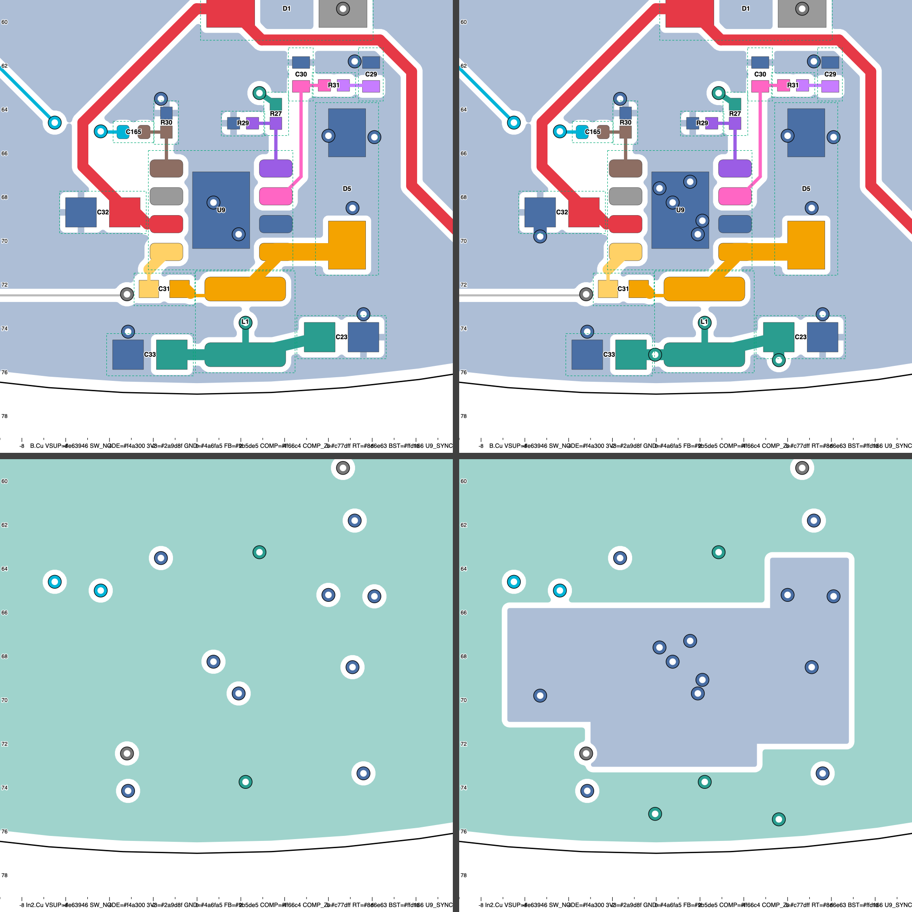

# Unified Control Board 36V v1.1: pre-order design review

**Project:** Unified Control Board (KiCad 10, 2 schematic sheets, 4-layer PCB), board revision v1.1
**Date:** 2026-11-21, on branch `36V-board-v1.1` after commit f79bc0be7
**Analyzers run (kicad-happy 2.2.1):** `analyze_schematic.py`, `analyze_pcb.py --full --proximity`,
`cross_analysis.py`, `analyze_emc.py`, `analyze_thermal.py`, `analyze_gerbers.py` (on the regenerated files), the
deep-review citation gate, plus KiCad's own ERC and DRC with schematic parity.

## Verdict

**Ready to order**, with three things for a person to do first:

1. Look the board over in KiCad. All v1.1 layout work was done by script.
2. In JLCPCB's placement preview, check the rotation of the moved buck parts (U9, L1, D5 and the small parts round
   them) and of the three new parts.
3. Confirm stock for the two capacitors that showed zero in the lookup (see Manufacturing).

The review found three weaknesses in the 3.3 V buck's layout, all left by the script that moved the buck in v1.1.
They are fixed. Nothing else needed a board change.

## Overview

A two-MCU control board on a 36 V bus:
- an ESP32-S3 module (U8) runs the XY side: four DRV8251A brushed-motor drivers (U2–U5), a TCA9546A I2C mux (U6)
  for the encoders, SD NAND (U7), USB-C;
- an STM32G474 (U20) runs two sensorless BLDC stages: two DRV8300 gate drivers (U21, U22), twelve AON7264E FETs, six
  5 mΩ shunts into the G474's op-amps and comparators;
- a TPS54360B buck (U9) makes 3.3 V from the bus or from USB.

v1.0 was built once (board 1) and both spindle motors reach 24,000 RPM on it. v1.1 changes the layout to cure the
buck's switching noise in the current sense (`REVISIONS.md`).

## Critical findings

| Severity | Issue | Status |
|---|---|---|
| CRITICAL | None found | |
| WARNING | U9's exposed pad had 2 ground vias (v1.0: 5) | Fixed: 5 |
| WARNING | The 3.3 V output reached its plane through one via and a 0.3 mm track (v1.0: 3 vias) | Fixed: 3 vias on 0.5 mm copper |
| WARNING | U9's switching loop had no nearby ground return, and the 36 V switch node sat over the 3V3 plane | Fixed: GND island on In2 under the loop, GND via at C32 |
| WARNING | DRV8251A supply margin: 36 V bus against 48 V operating and 50 V absolute maximum, behind a TVS that clamps at 58 V | Unchanged from v1.0; no change for this order |
| WARNING | Two capacitors showed zero stock in the lookup (C14663 ×25, C19666 ×1) | Confirm at order time; a substitute for C14663 is already in the BOM |

## Previous review delta

The project's analysis manifest lists runs from 2026-09-18 and 2026-09-24, on an older design. Their JSON files are
not in this worktree, so no automatic diff was possible. `jlcpcb/ORDER_NOTES.txt` records the changes of the
2026-11-05 pre-order review and the 2026-11-16 footprint fix; both are still in place (checked: IPROPI resistors
680 Ω, C160–C163 fitted, D5's pads along the lead axis).

## Component summary

| Type | Count |
|---|---|
| Resistors (incl. 2 NTC) | 96 |
| Capacitors | 86 |
| ICs and modules | 11 (+ XT60 drawn as U1) |
| Transistors | 14 (12 FETs, Q1 P-FET, Q30 NPN) |
| Diodes, LEDs, optos | 12 |
| Connectors | 13 |
| Switches, inductor, mounting hardware | 6 |
| Total | 239, plus 6 fiducials on the PCB |

192 nets, 79 unique parts. Every part has a manufacturer part number and an LCSC number.

## Power tree

```
XT60 (U1) -- VIN_RAW --[Q1 ME50P06 P-FET, soft start: R59 47k / R60 100k, C72 10 uF G-S, C73 220 nF D-G, D6 15 V]--> VCC (36 V bus)
   VCC: D3 SMCJ36A TVS; bulk 3x330 uF + 2x100 uF + 4x22 uF; In1 plane
   VCC --> U2-U5 DRV8251A (VM)            4 brushed motor drivers
   VCC --> Q10..Q25 half bridges          2 BLDC stages, 5 mR shunts
   VCC --[R170 10k, D10 13 V, Q30 BCX56 follower]--> 12V_GD (12.3 V) --> U21, U22 DRV8300 (GVDD)
   VCC --[R171 100k / R172 6.8k]--> VBUS_SENSE (2.29 V at 36 V) --> U20 PA0
   VCC --[D1]--+
USB VBUS -[D2]-+--> VSUP (35.6 V, or 4.6 V on USB) -- C28 220 uF, C32 10 uF
   VSUP --> U9 TPS54360B buck, 500 kHz (R30 200k), L1 4.7 uH, D5, C33 22 uF + C23 10 uF --> 3V3 (3.28 V)
      FB: R27 62k / R29 20k -> 0.8 V x (1 + 62/20) = 3.28 V
      3V3 --> U8 ESP32-S3, U20 G474 VDD, U6, U7, sensors, logic
      3V3 --[R178 4.7 R, C164 22 uF + C145 1 uF]--> 3V3A --> U20 VDDA / VREF+, sense bias, NTC dividers
```

- U9's Vout uses the datasheet's 0.8 V reference (TPS54360B, p.5); the divider gives 3.28 V.
- U9's EN is open: correct, it has an internal pull-up (p.3, "Float to enable").
- USB alone runs both MCUs: VSUP is then about 4.6 V against the buck's 4.5 V minimum input. That works on board 1
  but has little margin; use a good port and a short cable.
- Q1 limits inrush: the bus rises at about 1.2 V/ms (0.27 mA of gate current into C73), well under the DRV8251A's
  2 V/µs limit (p.4).

## Analyzer verification

- **Component count:** schematic 239, PCB 245 footprints = 239 + 6 fiducials. Match.
- **Schematic parity:** KiCad DRC with parity reports 0 issues, so every pad's net matches the schematic.
- **Pinouts against datasheets:**

| Ref | Part | Checked against | Result |
|---|---|---|---|
| U9 | TPS54360BDDAR | Datasheet p.3 pin table: 1 BOOT, 2 VIN, 3 EN, 4 RT/CLK, 5 FB, 6 COMP, 7 GND, 8 SW, pad GND | Match |
| U21, U22 | DRV8300DRGER | Datasheet 24-pin RGE pin table, all 25 pads | Match |
| U2–U5 | DRV8251ADDAR | Datasheet p.3 pin table, all 9 pads | Match |
| U20 | STM32G474RBT3 | PB4 = TIM3_CH1 (AF2) in the alternate-function table. Other pins: the firmware repo's `check_pins.py` (0 mismatches) and board 1 running | Match / field-proven |
| U6, U7, U8, USB1, Q1, Q10–Q25, Q30 | | Not re-read against PDFs. Internally consistent, and exercised on board 1 (USB flashing, SWD, both motors) | Field-proven, not datasheet-verified in this review |

The analyzer classifies the eleven `CN` connectors as capacitors and the XT60 (`U1`) as an IC. Findings that rest on
that are listed under false positives.

## Deep review

Eight findings, all passed the citation gate (`analysis/deep_review.json`).

1. **U9 exposed pad: 2 vias, now 5.** TI: "Connect the PowerPAD to internal PCB ground planes using multiple vias
   directly under the device" (TPS54360B p.36). Three top-layer tracks cross above the pad; the new vias sit in the
   gaps between them, each at least 0.25 mm clear.
2. **Switching-loop ground return.** TI: "minimize the loop area formed by the bypass capacitor connections, the VIN
   pin, and the anode of the catch diode" (p.36).
   - Before: on the bottom layer, C32's ground pad and D5's anode were in separate pours. The return current went up
     to the top-layer pour through vias 5–10 mm away. In2 under the loop was the 3V3 plane.
   - Now: a GND island on In2 (109 mm², 9 stitching vias) lies 0.2 mm under C32, U9, D5 and the switch node, and C32
     has a ground via 1.1 mm from its pad. The switch node now faces ground, not the 3V3 plane.
   - v1.0's loop was no better than v1.1's was. This is the "hot-loop ground return" item from the board 1 bring-up
     notes.
3. **3V3 output: 1 via, now 3.** Two more vias on the output copper, between C33 and L1 and below C23.
4. **Sync input.** PB4 → C165 10 pF → RT/CLK with R30 to ground is TI's recommended coupling (p.16). The clock must
   exceed 2.0 V at the pin (p.5). Through 10 pF that is 3.3 V × 10/(10 + C_pin): 2.5 V if the pin is 3 pF, 2.0 V if
   it is 6.5 pF. TI does not give the pin's capacitance, so check it at bring-up; 22 pF at C165 adds margin.
5. **PB4.** TIM3_CH1 is AF2 on PB4. Firmware should set `UCPD1_DBDIS` (the G474 can switch a 5.1 kΩ pull-down onto
   PB4) and drive PB4 low when not syncing: TI calls RT/CLK "sensitive to noise" and U9_SYNC is 45 mm long.
6. **DRV8300 MODE and DT open, 3.3 V logic.** Within the datasheet: MODE floating is non-inverted, DT floating is the
   fixed dead time, logic high is 2.0 V.
7. **DRV8251A supply margin** (warning, unchanged from v1.0). 48 V operating, 50 V absolute maximum. D3 conducts from
   40–44 V and clamps at 58 V at its rated surge. Spindle braking must not pump the bus.
8. **U9 EN open.** Correct.



## Signal and power analysis

- **Regulators:** one switching regulator (U9), covered above. 12V_GD is a zener-referenced emitter follower:
  about 7 mA load, 0.17 W in Q30.
- **Buck ripple:** 4.7 µH at 36 V and 500 kHz gives 1.3 A peak-to-peak inductor ripple and about 18 mV on 3V3. That
  ripple is what reached the current sense in v1.0 through the ferrite. R178/C164 attenuate it by about 40 dB at
  500 kHz as laid out (the 22 µF sits 13 mm of thin track from R178), which leaves under 0.2 counts at the ADC.
- **3V3A drop:** about 10 mA through 4.7 Ω is 50 mV. VREF+ and the sense bias share that node, so offsets stay
  ratiometric; current gain shifts by 1.5 %.
- **Current sense:** six 5 mΩ low-side shunts, 1 kΩ / 100 pF filters, 31.6 kΩ bias to 3V3A, into the G474's PGAs.
  Unchanged; verified on board 1.
- **Dividers:** VBUS 100k/6.8k reads 2.29 V at 36 V (board 1 measured 2.32 V at 36.5 V) and tops out at 51.8 V.
- **I2C:** TCA9546A with pull-ups on each channel; address pins grounded; reset tied high.
- **USB:** CC1/CC2 each 5.1 kΩ to ground. No ESD parts on D+/D− or VBUS, and nothing loads VBUS: with 36 V on and no
  cable, D2's leakage lets the VBUS pins float up towards 36 V at microamps. Harmless, but a 10 kΩ bleed would be
  tidier (suggestion).
- **SPICE:** not run, no simulator is installed.

## PCB layout

- **Board:** 102.3 × 121.5 mm, 4 layers, 1.6 mm. F.Cu and B.Cu are GND pours with signals; In1 is the VCC plane; In2
  is the 3V3 plane with GND islands under the motor stages and now the buck.
- **Routing:** 2169 segments, 583 vias, all 0.6/0.3 mm. DRC: 0 errors, 0 unconnected, nothing dangling.
- **Planes against v1.0:** the VCC plane is one piece. The 3V3 plane has 6 islands (v1.0: 7); the three small ones
  with a single via each are in v1.0 too. No GND pour island is cut off (`repair.py --list`).
- **Power track widths:** no power net is narrower than in v1.0 (checked per net).
- **Via-in-pad:** 117 vias sit in 57 SMD pads (v1.0: 111 in 51). The six new pads come from the buck move (D5's
  anode) and the route review (R135, R165, U2 pin 3, U8 pins 8 and 12). The board is ordered with filled and capped
  vias, which this needs.
- **Edge distances:** C33 1.0 mm, L1 1.15 mm and C23 1.45 mm from the bottom edge, after the buck move. v1.0 already
  has parts at 0.5–0.9 mm (SW1–SW3, C72, D3).
- **Thermal pads:** U9 5 vias; DRV8300 4 each; DRV8251A 8–11 each; FETs 4–5 each under the drain pad. Unchanged
  except U9. Board 1 ran both motors to 24,000 RPM with these.
- **Thermal:** U9 dissipates about 0.16 W at 1 A (the analyzer's own estimate is lower): under 15 °C rise. The
  analyzer assessed no other part; the stages' temperatures come from the bench, not from this review.

## EMC and cross-domain

The EMC analyzer's 70 warnings and errors are mostly one structural fact: the board has no solid ground plane.
Ground is the two outer pours, and signals on the outer layers cross gaps in them. That is v1.0's architecture and
is not changed here. Its buck findings (hot loop, harmonics) are addressed by the In2 island. The USB findings are
the missing ESD parts noted above.

## Manufacturing

- **Order files regenerated** from this board: gerbers (11 layers, aligned), PTH and NPTH drill, BOM, CPL.
  - Drill: 658 plated holes = 583 vias + 75 pad holes; 7 non-plated. Matches the board.
  - BOM: 69 lines, 238 parts. Against v1.0: FB1 out; R178, C164, C165 in.
  - CPL: only the 13 buck parts changed position; nothing else moved.
- **JLCPCB capability:** 0.1 mm tracks and spaces and 0.3 mm vias need the multilayer process v1.0 used. Via
  covering: epoxy filled and capped.
- **Stock** (community LCSC database, 2026-11-21; it can lag): all 69 part numbers resolve to the intended parts.
  - C14663 (100 nF/50 V 0603, 25 places) and C19666 (4.7 µF 0603, C144) showed 0.
  - C53672 (IR LED) 105; C2830323 (SD NAND) 583.
  - STM32G474RBT3 3190, DRV8300DRGER 44,899, AON7264E 30,695.
- **Test points:** none. The SWD pads (J1) and connectors are the only probe points.

## False positives and overrides

| Analyzer finding | Why it is not a problem |
|---|---|
| KO-001 ×50, vias inside keep-outs `ISL_nn` | Those areas are the board's custom per-net island rules, which allow their own nets. KiCad's DRC, which runs the real rules, passes |
| VM-001 ×12, INH/INL "12 V / 3.3 V crossing" | DRV8300 logic inputs are 3.3 V compatible (VIH 2.0 V) |
| PU-001, MODE (U21, U22) and EN (U9) without pull resistors | Internal pull-down / pull-up; open is the documented connection |
| PP-001, U9 VIN "no DC path" | VSUP is fed through D1 and D2 |
| RS-001 ×4 and ERC "pin not driven" ×46 | Imported symbols with input-type pins and no power flags; same as v1.0 |
| DC-002, no decoupling near U1 | U1 is the XT60 connector |
| GR-004, paste apertures fewer than copper flashes | The copper count includes vias and through-hole pads |
| DFM-001, tracks need the "advanced" tier | Known: the Fine net class is 0.1 mm, as ordered for v1.0 |
| TV-001, FET and DRV8300 thermal vias "insufficient" by one | Heuristic thresholds; unchanged from the board that runs |

## Not performed / limits

- **SPICE simulation:** no simulator installed.
- **Lifecycle audit:** not run (no distributor API keys). The LCSC stock lookup above stands in for it.
- **Prior-run diff:** earlier analyzer output is not in this worktree.
- **Datasheet verification** covers U9, U21/U22, U2–U5 and PB4 on U20. The other parts were not re-read against
  PDFs; they are unchanged from v1.0 and exercised on board 1.
- **The XY side** (DRV8251A drivers, encoders through U6) was checked on paper only. Whether board 1 has run belts
  with it is not recorded in the notes this review read.
- **No bench measurement** backs the In2 island's benefit; it rests on TI's layout guidance and the geometry.

## Suggestions for a later revision

- A 10 kΩ bleed and a TVS on USB VBUS, and an ESD array on D+/D−.
- A lower-voltage TVS (33 V) or a bus clamp, for margin under the DRV8251A's 48 V.
- Test points on 3V3, 3V3A, 12V_GD and the sync clock.
- A board-revision strap on a spare G474 pin (PD2), or keep the revision in the G474's stored calibration.
