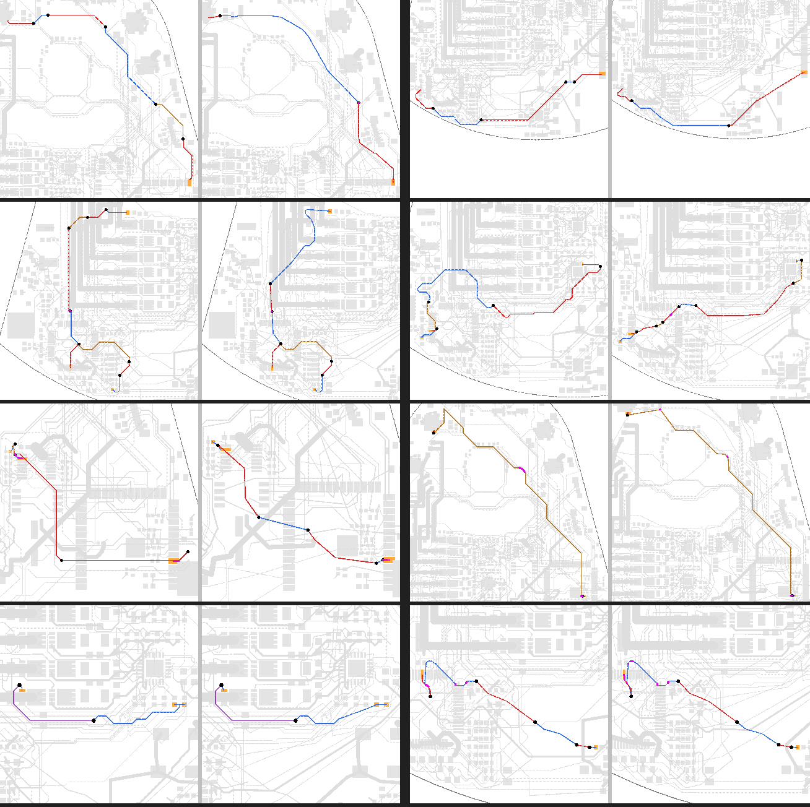
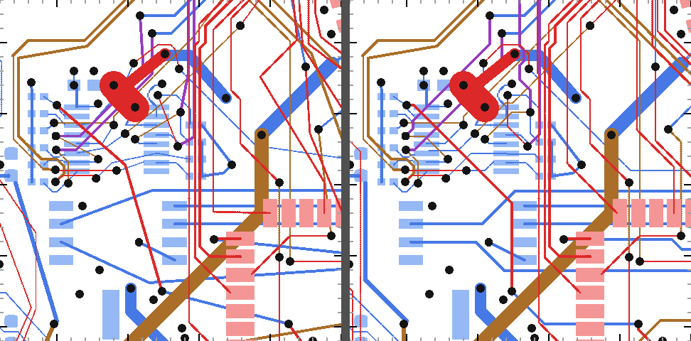
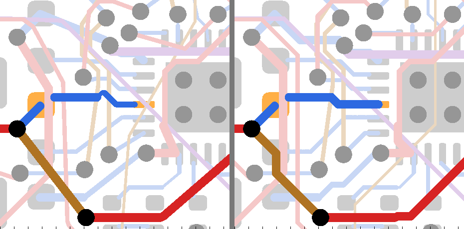

# Unified Control Board 36V v1.1: route review

Every routed net, traced one at a time, for stubs, loops, detours and anything else odd. This file is the running
log. It started on 2026-11-21 from commit 1f082cd76.

## How the routes are traced

`tools/netreview.py` builds each net's copper the way KiCad connects it, with one difference: it errs on the side of
calling copper connected. A via or track end whose copper overlaps a track or pad counts as connected, as KiCad's own
ratsnest does. On that model it reports:

- **dead**: track pieces and vias that no path between two pads (or a pad and a zone) uses. These are stubs, including
  the ones DRC misses because their end happens to touch something.
- **loop**: copper that closes a loop. Links through zones don't count.
- **one-layer via**: a via whose copper is all on one layer, so it joins nothing between layers.
- **detour**: a pad-to-pad copper path much longer than the straight line between the pads. Only pairs whose path
  passes no third pad are checked.

It also draws each net on its own, so every route can be looked at.

## Step 1: stubs and fragments

- 19 dead pieces in 17 nets were removed or trimmed. All were under 0.5 mm: overshoots past a bend, or bits poking
  out of a via or pad. DRC does not count them as dangling because their ends touch something.
- 267 fragments were removed: segments lying wholly inside a via or pad of their own net, or shorter than 0.01 mm.
  They are left over from the router (Net-(U2-IPROPI) alone had 53 near-zero pieces). Some 0.5–2.2 mm runs inside big
  pads went too.
- GHB1_G's via at (−16.98, 42.08) joined two bottom-layer tracks that ended 0.23 mm apart inside it. They now meet at
  its centre and the via is gone.
- Result: 3194 → 2914 segments and 597 → 596 vias. DRC with schematic parity: no errors, nothing unconnected, nothing
  dangling, 219 warnings (was 237).

## Step 2: staircases and wiggles

- `tools/route_fix.py pull` takes each chain of same-layer, same-width segments between real junctions (pads, vias,
  zone edges, T-junctions, width changes) and string-pulls it. From each point it jumps to the farthest later point
  reachable in a straight line with full clearance: the board's rules plus 0.03 mm.
- The chain's ends stay put, so nothing gets connected or disconnected.
- Left alone on purpose: the sense nets (IS*, S[ABC][12]), U9_SYNC and the USB data pair, whose spacing was chosen.
- Result: 232 chains, 1294 → 747 segments, 82.7 mm of track gone. DRC with schematic parity: no errors, 201 warnings.
  The nine "new" ones are the same narrow VCC, USB5V and phase runs as before, now as merged segments with their
  widths kept.

## Step 3: detours, first pass

`tools/detours.py` drives `tools/reroute.py` over every pad-to-pad detour the checker reports, worst first:

- It takes the copper path between the two pads and splits it at real junctions.
- It removes the longest chain, including router fragments sitting on it, and joins the two parts of the net again
  by the shortest route kirouter finds. That route keeps full clearance plus 0.03 mm, uses top, In2 and bottom (never
  In1, the VCC plane that feeds the motor stages) and keeps off the analog nets.
- The new route is kept only if it is at least 15 % and 2 mm shorter, and a full DRC afterwards shows nothing new:
  no error, unconnected item or dangling track. Otherwise the board goes back.

A first run without the DRC gate was thrown away. It left router fragments disconnected, and some new routes split
GND and 3V3 pour islands.

Kept (old → new chain length):

| Net | Before | After |
|---|---|---|
| SCL | 72.5 mm, 5 vias | 48.6 mm, 3 vias |
| GHC1_G | 48.1 mm, 3 vias | 18.6 mm, 1 via (the high-side gate trace no longer loops round the FET rows) |
| BoardCOM2 | 99.6 mm, 7 vias | 73.9 mm, 3 vias |
| INLC2 | 35.6 mm, 3 vias | 27.8 mm, 2 vias |
| INHA2 | 60.0 mm, 3 vias | 46.1 mm, 4 vias |
| SDA3 | 84.2 mm, 5 vias | 65.7 mm, 3 vias |
| BR IN1 | 99.9 mm, 4 vias | 83.2 mm, 4 vias |
| VSUP (D2 to the hub) | 16.4 mm | 13.2 mm |
| SDA (R7 to U6) | 3.6 mm, 1 via | 1.1 mm |
| USB5V (VBUS pin B4 to B9) | 15.1 mm | 5.3 mm |
| Net-(U5-IPROPI) | 42.5 mm | 34.7 mm |
| GD_REF | 12.6 mm | 7.0 mm |
| GHB1 | 13.5 mm | 11.2 mm |
| ADC BL | 9.0 mm, 2 vias | 6.1 mm, 1 via |

Undone by DRC: SDA1, INHC1, BEAMBREAK, INLC1, BoardCOM1 and SWCLK.

DRC with schematic parity afterwards: no errors, nothing unconnected or dangling, 198 warnings. The two new warnings
are the new USB5V pin link, which is as narrow as the one it replaced.

## Step 3b–3d: more detour passes

| Pass | Rule | Kept (old → new chain) |
|---|---|---|
| 3b | 8 % and 3 mm shorter, at most one extra via | 12V_GD 74.7 → 63.9 mm; INLC1 66.3 → 54.8 mm; VAC_CONTROL 116.5 → 101.1 mm, 5 → 3 vias; INHC2 53.2 → 45.5 mm, 4 → 3 vias; SWDIO 22.4 → 18.8 mm, 2 → 3 vias |
| 3c | finer router grid; kirouter now also keeps out of keep-outs drawn inside footprints (J1's no-via area, which DRC had rejected SWCLK for) | DETECTORLED 90.3 → 78.9 mm, 4 → 5 vias; SWCLK 24.1 → 19.3 mm; GLB2_G 30.7 → 26.0 mm |
| 3d | `tools/repair.py` runs before the DRC gate: it removes copper the re-route left dead and stitches GND pour it cut off | INHB2 62.5 → 57.1 mm, 3 → 1 vias |

Left as they are:

- **INLA1, SCL, BL IN2.** Their shorter routes split the GND pour so that DRC found pads no longer connected. For
  INLA1 the split is inside the current-sense filter block, and for SCL it is U6 pin 13's pour. There is no room
  for a stitching via in either.
- **BEAMBREAK.** Its shorter route breaks clearance where it is forced past the J1 area.
- **BoardCOM1.** Its shorter route starves a thermal relief.

## Step 4: every net looked at, and what that turned up

**Loops.** Every loop the checker reports is harmless:
- FET and driver pads with more than one via, and the Kelvin taps;
- wide motor and power tracks that overlap their pads;
- vias that overlap their own pad.

The exception was GLC1_G (below).

**Per-net review.** All 142 routed nets were drawn one at a time, 12 to a sheet, and each one was looked at.
- Most long routes are long because of where things are. The INH/INL lines, for example, have to get from U20 (whose
  pins face away from the drivers) round the power stage blocks to U21/U22.
- The gate-drive traces (GH*/GL*) cross the stage area, where In1 is the VCC plane and In2 is the stage return, so
  they can only use the top and bottom layers between the FET pads.
- For each of these the router confirms that nothing shorter exists without In1.

Fixed by hand or by a targeted re-route:

| Net | What was odd | Now |
|---|---|---|
| Net-(U2-IPROPI) | After the via beside U2, the In2 track ran 9 mm north and came back south-east: an up-and-over around nothing that blocks a direct line | 20.2 → 11.4 mm, direct |
| GLC1_G | The track from the left ran past R106's pad to a T between R106 and R112, then back 0.7 mm into R106 (it kept the diagonal clear of R111's pad) | Bends once under R111 and enters R106 directly; R106 → R112 is one straight link |
| BL OUT2 | A 0.04 mm, 1 mm wide dot beside U5 pin 8 | Removed |
| Net-(U5-IPROPI) | A 0.1 mm overshoot past a bend | Removed |
| Sense nets, U9_SYNC, 3V3A | Staircases left from the first routing | String-pulled with 0.25 mm *extra* clearance instead of 0.03 mm, so their spacing from noisy copper only grows: 114 → 76 segments, 6.8 mm shorter |
| U9_SYNC at U20 | A 0.1 mm staircase on both layers next to the pin | Re-routed: 16.7 → 15.9 mm. The hairpin itself stays. There is no legal via spot next to pin 57, and the vias south of it fence the bottom layer, so the route has to go south to a via and back north under U20. On a 0.025 mm grid the router finds nothing shorter. |

BSTA2's bootstrap link (C121 to U22 pin 20) uses three vias over 7.2 mm. It looks odd but is needed. With top and
bottom only there is no route, and with In2 the best is 14.7 mm, still with three vias.

**Fewer vias.** reroute.py's `--fewer K` keeps a route only if it has at least K fewer vias and is no more than 0.5 mm
longer. With K = 2 and a via cost of 5 mm:

| Net | Before | After |
|---|---|---|
| BR IN2 | 92.6 mm, 5 vias | 90.2 mm, 2 vias |
| SPINDLE_RST_X | 78.2 mm, 4 vias | 77.4 mm, 2 vias |
| TEMP2 (RT2 to R174) | 46.6 mm, 5 vias | 46.8 mm, 3 vias; the GND pour island it cut off (R144's) is stitched at (−24.69, 33.30) |

**Much shorter with extra vias.** These were rejected earlier for adding vias. Kept now because they save at
least 10 mm and 15 %, with at most three extra vias:

| Net | Before | After |
|---|---|---|
| INHC1 | 83.4 mm, 3 vias | 52.2 mm, 6 vias |
| SDA (U8 to U6) | 53.0 mm, 3 vias | 42.3 mm, 5 vias |

SDA1 stays: its shorter route needs seven vias.

**The GND island check was wrong, and is fixed.** repair.py decides whether a change cut off a piece of GND pour.
- **What was wrong.** Its first version joined pads only to pours, never to tracks, and missed pads joined to a
  pour by thermal spokes alone. So it reported islands near U20 as cut off when they were connected, for example
  through U20 pin 47 and C143. It also took the biggest group of copper as "the" GND, not the one with the pads.
- **The effect.** It "stitched" three islands that were fine, and one of its vias sat 0.17 mm from an existing
  GND via. Those three vias are removed.
- **What it does now.** It joins copper only where copper meets: pad and pour (spokes included), track and pour,
  track ends on pads, vias and other tracks, T-junctions. The main GND is the group with the most pads.
- **Checked against known states.** It reports nothing cut off at v1.0, at 1f082cd76 or after step 3d. In a test
  copy with TEMP2's stitch removed, it finds R144's island, which DRC also flags.
- `repair.py <dir> --list` prints the cut-off islands and `--stitch-all` stitches them.

DRC with schematic parity after step 4: no errors, nothing unconnected or dangling, 198 warnings (unchanged).

## Step 5: detours inside routes

The pad-to-pad check can't see a detour in the middle of a long route, and Net-(U2-IPROPI)'s was one.
`netreview.local_detours()` walks every chain of copper between junctions. It flags any stretch at least 2 mm and
40 % longer than the straight line between its ends. It found 52 in 47 nets. 38 of those are in nets the re-router
may change: the rest are pours, or the sense nets, which stay as routed.

`detours.py --local` tried each one with step 3's rule and gate: at least 15 % and 2 mm shorter, at most one extra
via, then repair and a full DRC.

| Net | What changed | Before | After |
|---|---|---|---|
| BoardCOM1 | The stretch into U8 pin 9 started on an old In1 segment; it is now off the VCC plane | 19.0 mm | 11.7 mm |
| Axis Health LED | The hook back to its pad is gone | 33.1 mm, 1 via | 24.1 mm, 2 vias |
| SDA1 | Beside U6, the top-layer track climbed 6 mm north and came back down between two vias 6 mm apart | 13.8 mm | 6.4 mm |
| SPINDLE_BOOT_X | A down-and-up jog | 14.6 mm, 2 vias | 9.6 mm, 1 via |

At first DRC rejected SDA1 and SPINDLE_BOOT_X. The new route joined the net elsewhere and left an end via with
copper on one layer only, which KiCad calls dangling. repair.py now joins the track ends in such a via and removes
it, as `route_fix.py via1` does, and both then passed.

Every other window stays, because the router's best alternative is no better:

| Result | Nets |
|---|---|
| Longer | SCL1, TR IN2, INLC2, INLB2 (two windows), ADC TR |
| About the same | GHB1_G, INHB2 |
| No legal route at all without In1 | INLA1, GLA1_G (GLA1_G's 38.6 mm stretch with 3 vias is the low-side gate trace going round the stage blocks) |
| DRC still finds GND split | SCL (U6 pin 13's pour) |

Some windows had a shorter route, but only with three or more extra vias, so they stay:
- SDA1's main run: 88.4 → 80.3 mm, 0 → 7 vias;
- INLC1: 54.8 → 42.1 mm, 1 → 4 vias;
- BEAMBREAK: 33.6 → 26.3 mm, 1 → 4 vias.

**INHC1, again.** Step 4's shorter INHC1 crossed U20's via field with four layer changes in 14 mm. A `--fewer 2`
re-route of that stretch (allowed up to 4 mm longer) found it with two: 20.1 mm, 4 vias → 20.4 mm, 2 vias.

## Step 6: final tidy

- **String-pull.** `route_fix.py pull` ran over every net again (full clearance plus 0.03 mm; the sense nets,
  U9_SYNC and the USB pair skipped). It straightened 66 chains, mostly staircases the router left on re-routed nets:
  497 → 336 segments, 10.8 mm shorter.
- **Fragments under 0.06 mm.** 49 were left from v1.0's routing. 43 went:
  - 23 links inside a chain, merged into their neighbours (one on ISC1, where the copper moves by under 0.03 mm);
  - 5 micro-tails (0.01–0.04 mm, on TL OUT1, TR OUT2, SC1, PHC2 and PHB2), each covered by its neighbour's end;
  - 3 end pieces into a pad or via, absorbed by the neighbouring segment;
  - 2 that lay inside a via;
  - 2 identical INLB2 segments stacked on each other, one of which went.
- **Six fragments stay**, on INHA1, INHB1, INLA1 and INLB2. Each sits where v1.0's tracks are exactly at the
  clearance limit, and merging them moved a vertex into a clearance error (tried, and undone).

## Result after step 6

| | 1f082cd76 | Now |
|---|---|---|
| Track segments | 3194 | 1909 |
| Vias | 597 | 577 |
| Track length | 5795.7 mm | 5307.4 mm |

- **DRC with schematic parity:** no errors, nothing unconnected, no dangling tracks or vias. There are 189 warnings,
  against 237 at 1f082cd76. Most of the drop is track-width warnings that went with fragments and merged segments.
- **GND:** `repair.py --list` finds no pour island cut off from the main GND.
- **Tracing:** netreview finds no dead copper and no one-layer vias in any of the 141 routed nets.
- **What's left.** The detour checker still lists 162 pad-to-pad pairs, and every one was looked at on the net
  sheets. For each, the router's alternatives on top, In2 and bottom are longer, need three or more extra vias, or
  split the GND pour. Two kinds account for most of them:
  - the gate drive and INH/INL lines between U20, U21/U22 and the FETs;
  - nets that cross the board round the stage blocks.

## Step 7: hand edits from the v1.0 copy

Some hand edits were made on the board in the FluidNC-g474fw worktree, which is the v1.0 layout on branch
36V-G474-firmware, and are uncommitted there. They touch 16 nets and change only tracks and vias. Its copper is
identical to the v1.0 tag's, so each edit is a clean diff against v1.0. Each net was compared with v1.1:

| Result | Nets | Why |
|---|---|---|
| Applied | WiFi LED, INLA2 | Whole net; it fits v1.1 as drawn |
| Applied | TR IN2 | Its straightened jog; the copper it replaces was unchanged in v1.1 |
| Applied | BL IN1 | The straight run into its pad, with v1.0's upper section, which the new WiFi LED route sits beside. Its bottom section stays as v1.1 has it, because v1.0's crosses the re-routed Net-(U5-IPROPI) |
| Kept v1.1's | SDA3, INHC1, INLC1, 12V_GD, USB5V, INHB2, INLC2, SPINDLE_BOOT_X | v1.1's route is 2–32 mm shorter, or has fewer vias |
| Kept v1.1's | SB1 | Its v1.1 route is the U9-noise fix |
| Not applied | GHB1 | Its new via sits on INHA2's re-routed In2 track (a short) and too close to PHB1 |
| Not applied | INLA1 | The track that replaces its removed via runs into the re-routed INLC1 |
| Not applied | PHA1 | Breaks a connection. The shortened top track no longer reaches the top pour, which cuts Q10's bottom pour island off from the rest of PHA1. DRC on the v1.0 copy shows the same unconnected item |

The edits made in KiCad on this board itself are kept: SPINDLE_RST_X, SPINDLE_BOOT_X, PHC2 and TR IN2, moved onto
45/90. SPINDLE_RST_X's old 1.2 mm entry into U8 pin 39, which they left dangling, was removed.

## Step 8: back to 45/90 degrees

The string-pulls and router clean-ups of steps 2–6 cut corners at any angle. That left 37.7 % of the board's
track length (2006 mm) off the 45/90 directions; v1.0 had 1.5 %. `tools/octi.py` puts it back:

- **Runs.** A run is a stretch of track between pads, vias, junctions, width changes and pour connections. Before
  re-routing, a track is split where another track's end, a via or a pad lands on its middle, but never within
  0.15 mm of its ends: KiCad would call such a short piece dangling.
- **Which runs.** Every run with a segment off 45/90 is re-routed on its own layer, inside a 2 mm corridor round the
  old route. So is a run more than 0.4 mm longer than the 45/90 distance between its ends.
- **The search.** A* over the eight 45/90 directions on a 0.05 mm grid laid through the run's first end. Each 45° of
  turn costs 0.6 mm, so the route keeps few corners, and no turn is sharper than 90°. The last two non-parallel
  segments are stretched so the route lands exactly on the run's other end.
- **Clearances.** The board's clearance plus 0.05 mm. Routes keep off the analog nets as before. The sense nets,
  U9_SYNC and 3V3A keep at least the spacing their current route already has at its tightest point.
- **What is kept.** An off-angle run's new route if it is at most 12 % + 0.3 mm longer; a 45/90 run's only if
  0.2 mm shorter. Hand-routed nets (the step 7 ones and the KiCad edits) are only touched where off-angle.
- **The gate.** A full DRC follows, and runs near anything new go back. Then the pour check runs.

Two passes converted about 330 runs. Ten went back because their new route cut a pour (DRC can't always tell
which run did it, so these were found by putting runs back one at a time):

| Pour that was cut | Runs put back |
|---|---|
| The top pour around U20 pin 47 | INLB1 (top) |
| A ring of In2 tracks round a 3V3-plane patch at U20, which cut two 3V3 vias off | INLB1 (In2); INHA2 (In2) went back too while searching |
| R112's bottom pour island | GLC1_G, GLC1 |
| 3V3 at (8.2, 28.8) | 3V3, SDA, SDA1 (In2) |

PHB2's bump into U22 pin 15 (y 32.40 up to 32.22, then down to the pin at 32.65) was a v1.0 junction where the
pieces overlap instead of meeting. It ran through 0.15, 0.20 and 0.24 mm bits, too short for the pass to join up.
It is now one 0.3 mm run from C122: horizontal, one 45° step, straight into the pin. 0.3 mm is this board's width
for Kelvin pins, so its three narrow-track warnings went too.

A last sweep removed 126 pieces that lay wholly inside a pad or via of their own net: router landing steps and v1.0
leftovers.

What stays off 45/90 (156 mm):
- **3V3 (45 mm).** Re-routed in the first pass, but its new runs broke plane connections, so its old ones stand.
- **PHA2 (20 mm).** Its wide motor tracks don't fit a 45/90 route in their corridor even 4 mm wide. v1.0 already had
  12 mm off-angle there.
- **SDA1, INLB2, GHA2_G and some GND tracks** (10–16 mm each). Put back for pour connectivity, or no 45/90 route fits.
- **WiFi LED.** Its curve is drawn as many tiny segments, and stays as drawn.

85 grid-step pieces under 0.06 mm remain. These are the one-cell (0.05 mm) jogs and end steps that let a 45/90
route line up with a pad or a gap. They are 45/90 themselves; merging them would put the neighbours off-angle.

## Result after step 8

| | 1f082cd76 | After step 6 | Now |
|---|---|---|---|
| Track segments | 3194 | 1909 | 2167 |
| Vias | 597 | 577 | 577 |
| Track length | 5795.7 mm | 5307.4 mm | 5329.7 mm |
| Track length off 45/90 | 4.3 % | 37.7 % | 2.9 % |

- **DRC with schematic parity:** no errors, nothing unconnected, nothing dangling, 192 warnings. These are the same
  kinds as before. Track-width warnings on narrow phase taps vary with how many segments a tap is drawn in.
- **GND:** `repair.py --list` finds no pour island cut off.
- **Tracing:** netreview finds no dead copper and no one-layer vias in any of the 141 nets.
